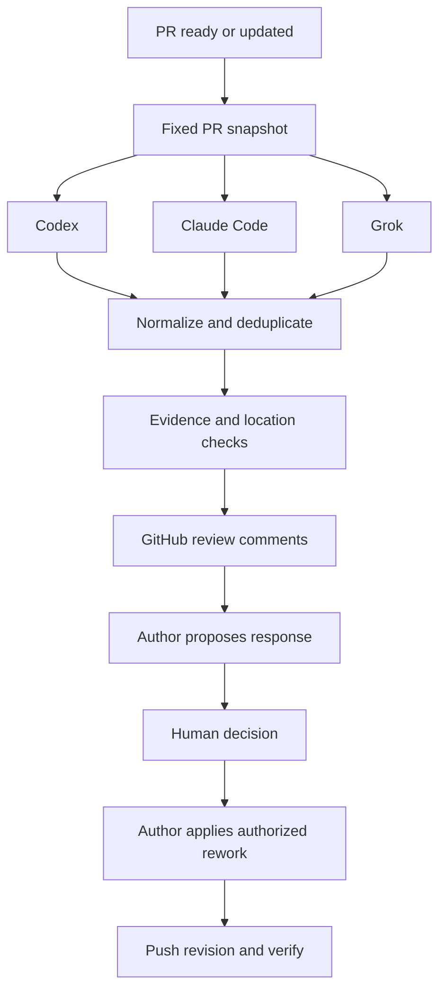

# Agent PR Review

Automatic PR reviews from Codex, Claude Code, and Grok, followed by author assessment and a human decision before rework.

**Status: M1 implementation.** The local CLI captures a PR, runs a bounded Codex review, and writes JSON/Markdown reports. The fake adapter supports offline testing. Automatic review comments, other providers, author assessment, and human decisions remain planned.

## Run M1 locally

Requirements: Node.js 24.18.0 (see `.nvmrc`), Git, GitHub access through `gh auth login` or `GH_TOKEN`, and a Codex login stored in `auth.json` or `OPENAI_API_KEY`. M1 is tested against **Codex CLI 0.162.1** and rejects other versions until their protocol/configuration is validated. Keychain-only Codex credentials are not yet supported by the isolated adapter.

```sh
npm ci --ignore-scripts
npm run build

# Use the tested CLI without replacing a globally installed Codex:
npm exec --yes --package=@openai/codex@0.162.1 -- node dist/cli.js doctor
npm exec --yes --package=@openai/codex@0.162.1 -- node dist/cli.js review https://github.com/OWNER/REPO/pull/123 --model YOUR_ACCESSIBLE_MODEL_ID

# Offline demonstration; deliberately exits 2 because this is a simulation:
node dist/cli.js review --reviewer fake --fixture tests/fixtures/pr.json
```

If Codex 0.162.1 is already on PATH, run `node dist/cli.js review ...` directly. Supply a model available to your account; the tool does not choose or substitute one. `doctor` checks installation and credential presence, not model entitlement.

Reports are saved under `.pr-review/runs/<run-id>/report.json` and `report.md`. They contain private source context; keep them out of Git and manage their retention. The run deletes its temporary Git snapshot and temporary Codex credential copy after completion. An abrupt process kill can leave temporary files; remove that run's `provider` directory before sharing artifacts.

Use `--config pr-review.example.json` for limits, `--context-file src/related.ts` to include additional source from the captured head, and `--output <directory>` to choose the report parent. Run `node dist/cli.js review --help` for supported options. CLI options override JSON configuration; unknown config fields are rejected.

M1 passes changed files (before/after), a locally generated diff, PR intent, and explicitly requested context to an isolated Codex session. Shell, execution host, browser, plugins, MCP configuration, and agent delegation are disabled; user config and rules are not inherited. The adapter requests a read-only sandbox and rejects tool-use events. It does not execute repository tests or provide autonomous repository exploration. This is a bounded text review, not a claim of whole-repository analysis or OS-level isolation against a compromised CLI.

Large/binary files, unsupported paths, symlinks, and submodules are listed as exclusions. Git computes the complete changed-file list, avoiding GitHub's paginated or truncated patch responses. Size limits are applied to the review packet; the temporary Git fetch still needs history to compute the merge base and can be large.

Exit codes: `0` completed within supplied scope; `1` failed or invalid input; `2` partial coverage, model-reported limitations, rejected findings, or simulation; `130` cancellation/deadline. Findings themselves do not cause a failing exit code. A partial or simulated zero-finding report never claims a clean review. GitHub publication is not implemented, including when `--dry-run` is omitted.

## Development checks

```sh
npm run check
npm run build
npm test
```

Tests use synthetic Git repositories and a fake adapter; they do not need model credentials or post comments. CI runs these checks on Linux and Windows. Real provider verification is run separately.

## Intended workflow

1. When a PR is ready or updated, capture a fixed base/head revision and gather relevant repository context.
2. Run independent reviewer agents, merge duplicates, validate evidence, and publish comments to GitHub.
3. Hand the findings to the original coding agent, locally or in the cloud.
4. The author proposes fixes, explains disagreements, and flags questions requiring a human decision.
5. The human decides which changes to authorize; the author waits until then.
6. After the author pushes a revision, verify prior findings and inspect the new diff. The human decides whether to merge.



## Later workflow commands

These commands describe the target interface; they are not available yet.

```sh
pr-review review https://github.com/owner/repo/pull/123 --reviewers codex,claude,grok --cross-review --dry-run
pr-review publish .pr-review/runs/<run-id>/report.json
pr-review handoff https://github.com/owner/repo/pull/123
```

These future GitHub Actions runs will publish automatically. Comments will identify reviewer provenance and any optional cross-validation. One publisher account will own the GitHub comments. The handoff command will prepare an assessment request for an existing local or cloud author session; automatic session resumption is provider-dependent and deferred until verified.

## Confirmed workflow choices

- Mixed local and cloud coding agents.
- Automatic reviews when a PR becomes ready or its code is updated; skip drafts.
- Author assessment before rework: accept, disagree, or needs human decision, each with evidence or a concrete proposal.
- Explicit human decision before code changes. Version 0.1 produces a decision report and portable handoff; the user directs their existing author agent to perform authorized work.
- GitHub is the shared review workspace. Reviewer-to-reviewer debate is optional; a standalone UI is deferred.

## Project documents

- [Implementation plan and acceptance criteria](docs/PLAN.md)
- [Architecture and review policy](docs/ARCHITECTURE.md)
- [Official integration references](docs/REFERENCES.md)

## Initial scope

GitHub.com pull requests; TypeScript CLI; native CLI reviewer adapters; automatic GitHub Actions reviews; repeatable reports and comments; author assessment handoffs; human decision records; revision verification. Review and assessment operate on bounded snapshots, with no autonomous rework loop.

Automatic code changes, automatic merges, a hosted dashboard, GitLab/Bitbucket support, and a multi-tenant GitHub App are deferred. No license has been selected yet.
