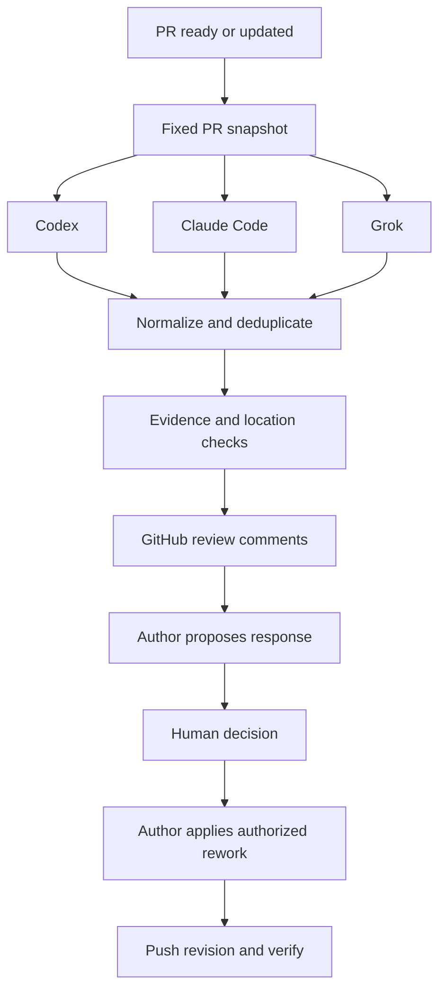

# Agent PR Review

Automatic PR reviews from Codex, Claude Code, and Grok, followed by author assessment and a human decision before rework.

**Status: M4 local worker.** Independent Codex, Claude Code, and Grok reviews run through browser-authenticated official CLIs. A local worker detects ready PRs and new revisions and publishes comment-only GitHub reviews with duplicate protection. API-key hosted execution is optional. Author assessment and human decisions remain M5.

## Recommended: local worker + CLI

Use existing subscription logins on your computer. No provider API keys are required; worker configuration rejects API auth and automatic fallback.

```sh
npm ci --ignore-scripts
npm run build
npm ci --ignore-scripts --prefix tools/agents
node tools/agents/bootstrap.mjs

# Check model IDs in examples/worker.browser.json, then start:
npm run worker -- OWNER/REPO

# One PR, review/preview only:
npm run worker -- OWNER/REPO --pr 123 --once --preview
```

The computer must be online; provider failures pause that reviewer until explicit resume. Subscription allowance and any account-level paid-overage settings still apply. See [worker setup and recovery](docs/WORKER.md).

## Run locally

Requirements: Node.js 24.18.0 (see `.nvmrc`), Git, GitHub access through `gh auth login` or `GH_TOKEN`, and the official CLI and credentials for each selected provider. Tested protocols are **Codex 0.162.1**, **Claude Code 2.1.293**, and **Grok 1.0.50**; other versions are rejected pending validation. Only selected providers need to be installed.

```sh
npm ci --ignore-scripts
npm run build

# Use the tested CLI without replacing a globally installed Codex:
npm exec --yes --package=@openai/codex@0.162.1 -- node dist/cli.js doctor
npm exec --yes --package=@openai/codex@0.162.1 -- node dist/cli.js review https://github.com/OWNER/REPO/pull/123 --model YOUR_ACCESSIBLE_MODEL_ID

# Claude or Grok with existing browser credentials:
node dist/cli.js doctor --reviewer claude --auth browser
node dist/cli.js review https://github.com/OWNER/REPO/pull/123 --reviewer claude --model YOUR_CLAUDE_MODEL_ID --auth browser
node dist/cli.js review https://github.com/OWNER/REPO/pull/123 --reviewer grok --model YOUR_GROK_MODEL_ID --auth browser

# Edit model IDs in this example, then review with all three:
npm exec --yes --package=@openai/codex@0.162.1 -- node dist/cli.js review https://github.com/OWNER/REPO/pull/123 --config pr-review.multi.example.json

# Offline demonstration; deliberately exits 2 because this is a simulation:
node dist/cli.js review --reviewer fake --fixture tests/fixtures/pr.json
```

If Codex 0.162.1 is already on PATH, run `node dist/cli.js review ...` directly. Supply a model available to your account; the tool does not choose or substitute one. `doctor` checks installation and credential presence, not model entitlement.

Authentication: all three providers support explicit `--auth browser` using their official file-backed login. This route ignores inherited API keys and refuses missing/unsupported browser credentials. Explicit `--auth api-key` requires the corresponding provider key. The general single-run CLI retains automatic auth selection when `auth` is omitted; the local worker refuses that mode. Authentication errors never trigger an automatic switch or retry. Keychain-only credentials are not supported. CLI paths are resolved from PATH; no global install is changed by this tool.

Reports are saved under `.pr-review/runs/<run-id>/report.json`, `report.md`, and `normalized-findings.json`. Schema version 2 has a `providers` array with individual status, requested/reported model, CLI version, timings, usage, errors, original candidates (`rawResult`), and evidence-filtered findings (`result`). The top-level result retains the M2 concatenated format; the separate normalized artifact contains conservative groups, provenance, and held candidates. Cost values are CLI estimates. A provider may report a different canonical model ID from the requested alias; both are recorded. No actual model identifier is invented when the CLI omits it.

Reports contain private source context; keep them out of Git and manage their retention. Temporary Git snapshots and provider homes are deleted after completion. An abrupt process kill can leave credential copies and logs; remove that run's `codex/provider`, `claude/provider`, and `grok/provider` directories before sharing artifacts.

Use `--config pr-review.example.json` for limits, `--context-file src/related.ts` to include additional source from the captured head, and `--output <directory>` to choose the report parent. Run `node dist/cli.js review --help` for supported options. CLI options override JSON configuration; unknown config fields are rejected.

Choose either the single-provider `reviewer`/`model`/`auth` fields or the multi-provider `reviewers` array. Each live reviewer requires an explicit model. Duplicate providers and mixed fake/live configurations are rejected. Optional per-reviewer `version` pins are checked against the installed supported CLI. `concurrency` defaults to 2 (maximum 3). `providerTimeoutSeconds` covers each provider's probe and review; `timeoutSeconds` covers capture and all reviewers, including queue time. Provider timeout or failure makes a usable report partial; failure of every provider makes it failed. Overall cancellation preserves reviews already finished and marks running/queued providers cancelled.

Each provider receives the same changed files (before/after), locally generated diff, PR intent, and explicitly requested context. Context and prompt hashes are identical across reviewers. Independent sessions never receive other reviewers' findings. Each uses a separate empty working directory and a sanitized environment with only its own credentials.

Codex disables tools, execution host, browser, plugins, MCP configuration, and delegation; it ignores user configuration/rules, requests a read-only sandbox, and rejects tool events. Claude disables built-in/MCP tools and session persistence, using bare mode for API keys or safe/restricted mode for browser credentials. Browser mode disables user/project customization and requests hooks disabled; administrator-managed policy still applies. The Claude environment preserves a configured `CLAUDE_CODE_GIT_BASH_PATH` on Windows.

Grok filters optional built-in tools, disables web tools/subagents and compatibility discovery, denies all tool permissions, and uses a temporary GROK_HOME. The pinned CLI retains its primary terminal definition even with an explicit tool filter; the deny-all policy blocks execution, and a successful review must pass a session audit rejecting tool calls or additional tool definitions. The audit also checks that the exact supplied prompt was recorded in the user transcript. Grok's prompt file avoids Windows command-line length limits; `--verbatim` requests exact input instead of CLI prompt preprocessing. Large packets can take longer or exceed a provider deadline; use explicit context limits and inspect exclusions/limitations. This is bounded text review, without repository test execution or autonomous exploration. It does not claim whole-repository analysis or OS-level isolation against a compromised CLI or trusted administrator policy.

Large/binary files, unsupported paths, symlinks, and submodules are listed as exclusions. Git computes the complete changed-file list, avoiding GitHub's paginated or truncated patch responses. Size limits are applied to the review packet; the temporary Git fetch still needs history to compute the merge base and can be large.

Review exit codes: `0` completed within supplied scope; `1` failed or invalid input; `2` partial coverage, model-reported limitations, rejected findings, or simulation; `130` cancellation/deadline. Findings themselves do not cause a failing exit code. A partial or simulated zero-finding report never claims a clean review. `review` always stays local; `publish` is the explicit GitHub mutation command.

## Publish a review

```sh
# Re-fetch source and save publication-plan.json / publication-preview.md:
node dist/cli.js publish .pr-review/runs/RUN_ID/report.json --dry-run

# Publish a COMMENT review at its captured head SHA:
node dist/cli.js publish .pr-review/runs/RUN_ID/report.json

# Partial coverage requires a deliberate opt-in, including for a preview:
node dist/cli.js publish .pr-review/runs/RUN_ID/report.json --allow-partial
```

Local publication requires a GitHub user token with PR read/write permissions, supplied by `gh auth login`, `GH_TOKEN`, or `GITHUB_TOKEN`. The hosted `actions publish` command supports the standard Actions bot token separately. General third-party App publisher identities remain deferred. No model credentials are needed by either publisher.

## Optional hosted API-key execution

The [hosted workflow](.github/workflows/agent-review.yml) reviews ready same-repository PRs when opened, reopened, marked ready, or updated. Review jobs use the trusted default-branch coordinator and can be cancelled by newer revisions; separate serialized publisher jobs post COMMENT reviews with durable retry protection. Drafts and forks are skipped. Source/report artifacts are retained for 30 days.

This is an opt-in deployment with separate provider API billing. For the recommended subscription-login path, use the local worker above. Hosted setup requires accessible API model IDs in [.github/agent-review.json](.github/agent-review.json), provider Actions secrets, and repository variable `AGENT_REVIEW_ENABLED=true`. Initial model placeholders and the disabled-by-default gate prevent accidental model calls. Browser credentials are not copied to hosted runners.

Manual retry and coding-bot event fallback:

```sh
node dist/cli.js dispatch https://github.com/OWNER/REPO/pull/123
```

See [Actions setup, trust, and recovery](docs/ACTIONS.md). M4 implementation is present; live automatic-trigger/API credential validation is pending setup and merge. The workflow does not yet ask the author to assess findings or authorize rework; that is M5.

Before any GitHub mutation, the publisher validates the report schema, hashes, provider results, and repository identity, re-fetches the exact source/metadata, and checks that the PR is open/ready with unchanged head/base SHAs. Schema-v2 M2 reports remain supported. Simulated, failed, and cancelled reports are refused. Source hashes are integrity checks, not signatures or proof that a model call occurred; the operator chooses the report to publish.

Only identical description/trigger/impact/evidence at the same anchor are deduplicated. Similar titles do not merge unrelated defects. Different claims sharing an anchor are retained as potential conflicts or separate defects for human inspection. Invalid anchors, placeholder claims, and comment-budget overflow stay in the summary/local plan. Default inline budget is 20 (`--max-comments`, up to 50). Model agreement alone does not qualify a finding.

Publication journals and per-PR local locks live in `.pr-review/publications`; use a shared `--state-dir` when invoking from different working directories. Repeating a report reconciles tool markers and publisher identity. Ambiguous create failures are never blindly retried; a later invocation reads remote state first. An unresolved outcome remains blocked pending inspection/remote visibility. Owned marked inline comments can be updated; replies, unmarked/foreign comments, and older-head discussions are preserved. The publisher never approves, requests changes, resolves threads, or merges.

An abrupt publisher termination can leave `publisher.lock`. Verify no publisher is running before removing that lock. Removing an uncertain journal can defeat duplicate protection; inspect the remote review before resetting state. Cross-machine races remain possible without distributed locking. CI publishers must use per-PR concurrency with cancellation disabled; automated CI publication is M4. See [publication policy and recovery](docs/PUBLICATION.md) for details.

Publish exits `0` after a successful preview or confirmed reconciliation, `1` on refusal/error, and `130` on user cancellation. A push racing a write can leave a comment at the older reviewed SHA; final freshness checks refuse to describe it as a review of the new head.

## Development checks

```sh
npm run check
npm run build
npm test
```

Tests use synthetic Git repositories and a fake adapter; they do not need model credentials or post comments. CI runs these checks on Linux and Windows. Real provider verification is run separately.

Native provider live smokes found the arithmetic regression in `tests/fixtures/pr.json`. Claude browser mode reported `claude-sonnet-5-5`; Grok requested `grok-4.7` and reported `grok-4.7-build`. Codex M1 smoke used `gpt-6.1-sol`. These are verification records, not default model choices.

## Intended workflow

1. When a PR is ready or updated, capture a fixed base/head revision and gather relevant repository context.
2. Run independent reviewer agents, merge duplicates, validate evidence, and publish comments to GitHub.
3. Hand the findings to the original coding agent, locally or in the cloud.
4. The author proposes fixes, explains disagreements, and flags questions requiring a human decision.
5. The human decides which changes to authorize; the author waits until then.
6. After the author pushes a revision, verify prior findings and inspect the new diff. The human decides whether to merge.



## Later workflow commands

These commands describe the target interface; they are not available yet.

```sh
pr-review review https://github.com/owner/repo/pull/123 --config pr-review.multi.example.json --cross-review --dry-run
pr-review handoff https://github.com/owner/repo/pull/123
```

These future GitHub Actions runs will publish automatically. Comments will identify reviewer provenance and any optional cross-validation. One publisher account will own the GitHub comments. The handoff command will prepare an assessment request for an existing local or cloud author session; automatic session resumption is provider-dependent and deferred until verified.

## Confirmed workflow choices

- Mixed local and cloud coding agents.
- Automatic reviews when a PR becomes ready or its code is updated; skip drafts.
- Author assessment before rework: accept, disagree, or needs human decision, each with evidence or a concrete proposal.
- Explicit human decision before code changes. Version 0.1 produces a decision report and portable handoff; the user directs their existing author agent to perform authorized work.
- GitHub is the shared review workspace. Reviewer-to-reviewer debate is optional; a standalone UI is deferred.

## Project documents

- [Implementation plan and acceptance criteria](docs/PLAN.md)
- [Architecture and review policy](docs/ARCHITECTURE.md)
- [Official integration references](docs/REFERENCES.md)
- [Publication policy and recovery](docs/PUBLICATION.md)

## Initial scope

GitHub.com pull requests; TypeScript CLI; native CLI reviewer adapters; automatic GitHub Actions reviews; repeatable reports and comments; author assessment handoffs; human decision records; revision verification. Review and assessment operate on bounded snapshots, with no autonomous rework loop.

Automatic code changes, automatic merges, a hosted dashboard, GitLab/Bitbucket support, and a multi-tenant GitHub App are deferred. No license has been selected yet.
