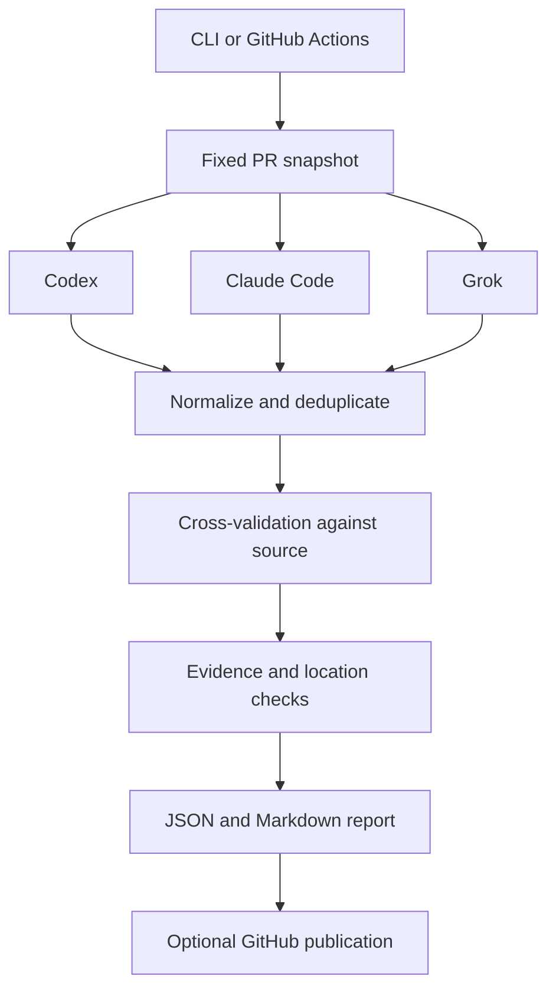

# Agent PR Review

Evidence-based pull request reviews from Codex, Claude Code, and Grok, coordinated through one CLI and published to GitHub.

**Status: planning.** This repository contains the project plan and architecture. The CLI, provider integrations, and automated review workflow are not implemented yet.

## Intended workflow

1. Capture a PR at a fixed base/head revision and gather relevant repository context.
2. Ask the selected agents to review independently.
3. Ask a different agent to verify each candidate finding against the code.
4. Merge duplicates and retain actionable findings supported by evidence.
5. Produce JSON and Markdown reports; optionally publish GitHub inline comments and a summary.



## Planned usage

These commands describe the target interface; they are not available yet.

```sh
pr-review doctor
pr-review review https://github.com/owner/repo/pull/123 --reviewers codex,claude,grok --cross-review --dry-run
pr-review publish .pr-review/runs/<run-id>/report.json
```

Review defaults to local output. Publication is an explicit command or a configured CI policy. Comments identify the originating reviewer and verification result; one publisher account owns the GitHub comments.

## Project documents

- [Implementation plan and acceptance criteria](docs/PLAN.md)
- [Architecture and review policy](docs/ARCHITECTURE.md)
- [Official integration references](docs/REFERENCES.md)

## Initial scope

GitHub.com pull requests; TypeScript CLI; native CLI adapters for Codex, Claude Code, and Grok; at most two review rounds; repeatable reports; explicit publication; GitHub Actions integration after the local workflow works.

Automatic code changes, automatic merges, a hosted dashboard, GitLab/Bitbucket support, and a multi-tenant GitHub App are deferred. No license has been selected yet.
