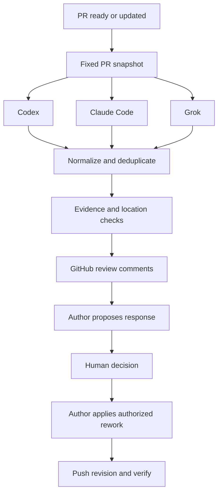

# Agent PR Review

Automatic PR reviews from Codex, Claude Code, and Grok, followed by author assessment and a human decision before rework.

**Status: planning.** This repository contains the project plan and architecture. The CLI, provider integrations, and automated review workflow are not implemented yet.

## Intended workflow

1. When a PR is ready or updated, capture a fixed base/head revision and gather relevant repository context.
2. Run independent reviewer agents, merge duplicates, validate evidence, and publish comments to GitHub.
3. Hand the findings to the original coding agent, locally or in the cloud.
4. The author proposes fixes, explains disagreements, and flags questions requiring a human decision.
5. The human decides which changes to authorize; the author waits until then.
6. After the author pushes a revision, verify prior findings and inspect the new diff. The human decides whether to merge.



## Planned usage

These commands describe the target interface; they are not available yet.

```sh
pr-review doctor
pr-review review https://github.com/owner/repo/pull/123 --reviewers codex,claude,grok --cross-review --dry-run
pr-review publish .pr-review/runs/<run-id>/report.json
pr-review handoff https://github.com/owner/repo/pull/123
```

Local review defaults to local output; configured GitHub Actions runs publish automatically. Comments identify reviewer provenance and any optional cross-validation. One publisher account owns the GitHub comments. The handoff command prepares an assessment request for an existing local or cloud author session; automatic session resumption is provider-dependent and deferred until verified.

## Confirmed workflow choices

- Mixed local and cloud coding agents.
- Automatic reviews when a PR becomes ready or its code is updated; skip drafts.
- Author assessment before rework: accept, disagree, or needs human decision, each with evidence or a concrete proposal.
- Explicit human decision before code changes. Version 0.1 produces a decision report and portable handoff; the user directs their existing author agent to perform authorized work.
- GitHub is the shared review workspace. Reviewer-to-reviewer debate is optional; a standalone UI is deferred.

## Project documents

- [Implementation plan and acceptance criteria](docs/PLAN.md)
- [Architecture and review policy](docs/ARCHITECTURE.md)
- [Official integration references](docs/REFERENCES.md)

## Initial scope

GitHub.com pull requests; TypeScript CLI; native CLI reviewer adapters; automatic GitHub Actions reviews; repeatable reports and comments; author assessment handoffs; human decision records; revision verification. Review and assessment operate on bounded snapshots, with no autonomous rework loop.

Automatic code changes, automatic merges, a hosted dashboard, GitLab/Bitbucket support, and a multi-tenant GitHub App are deferred. No license has been selected yet.
